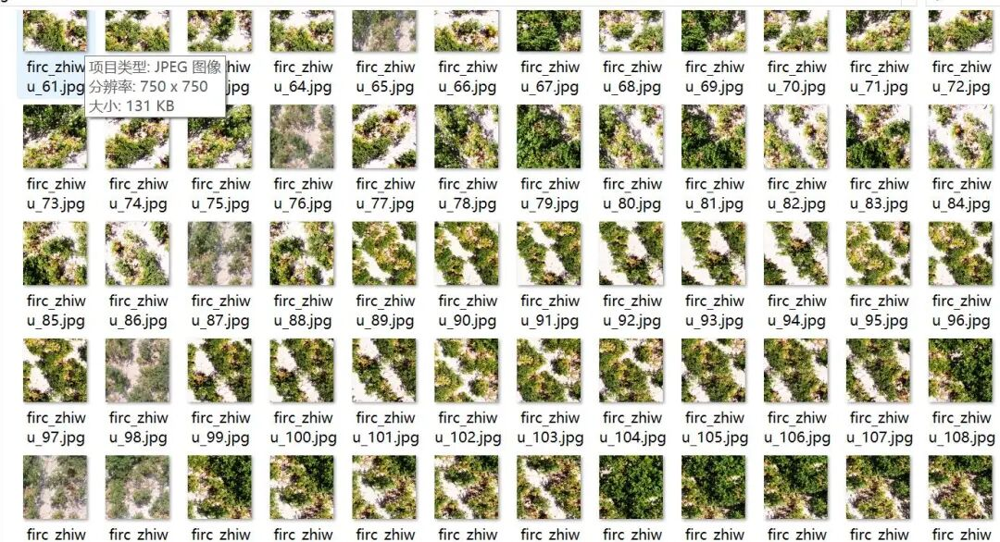
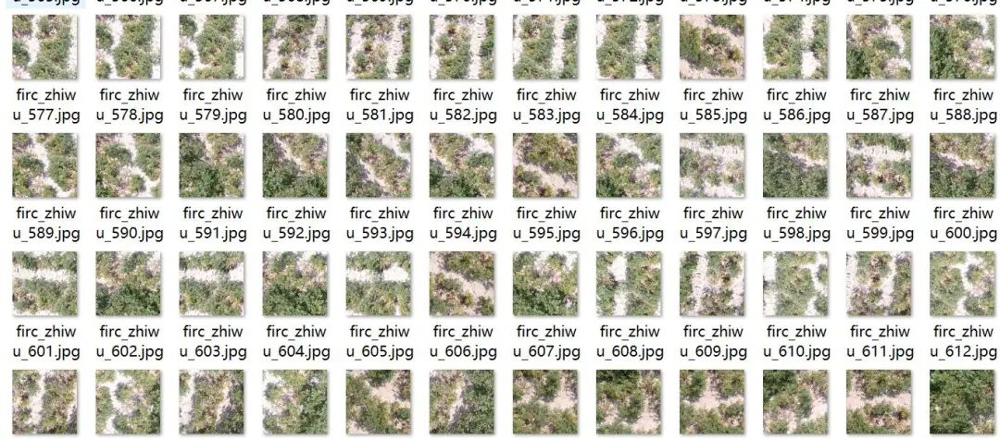
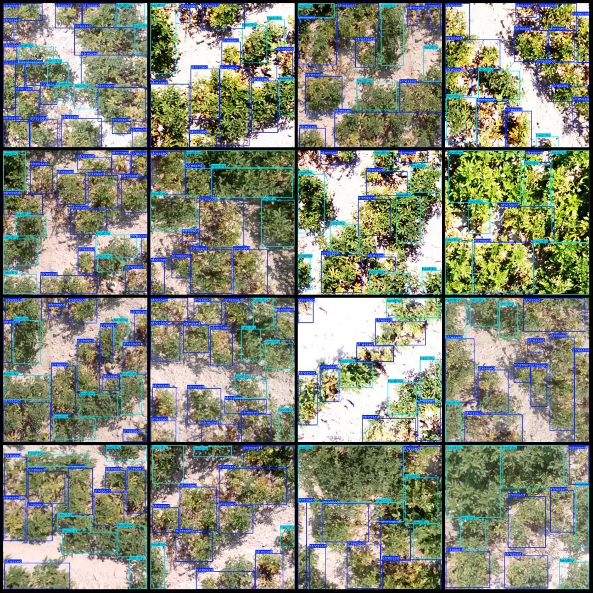
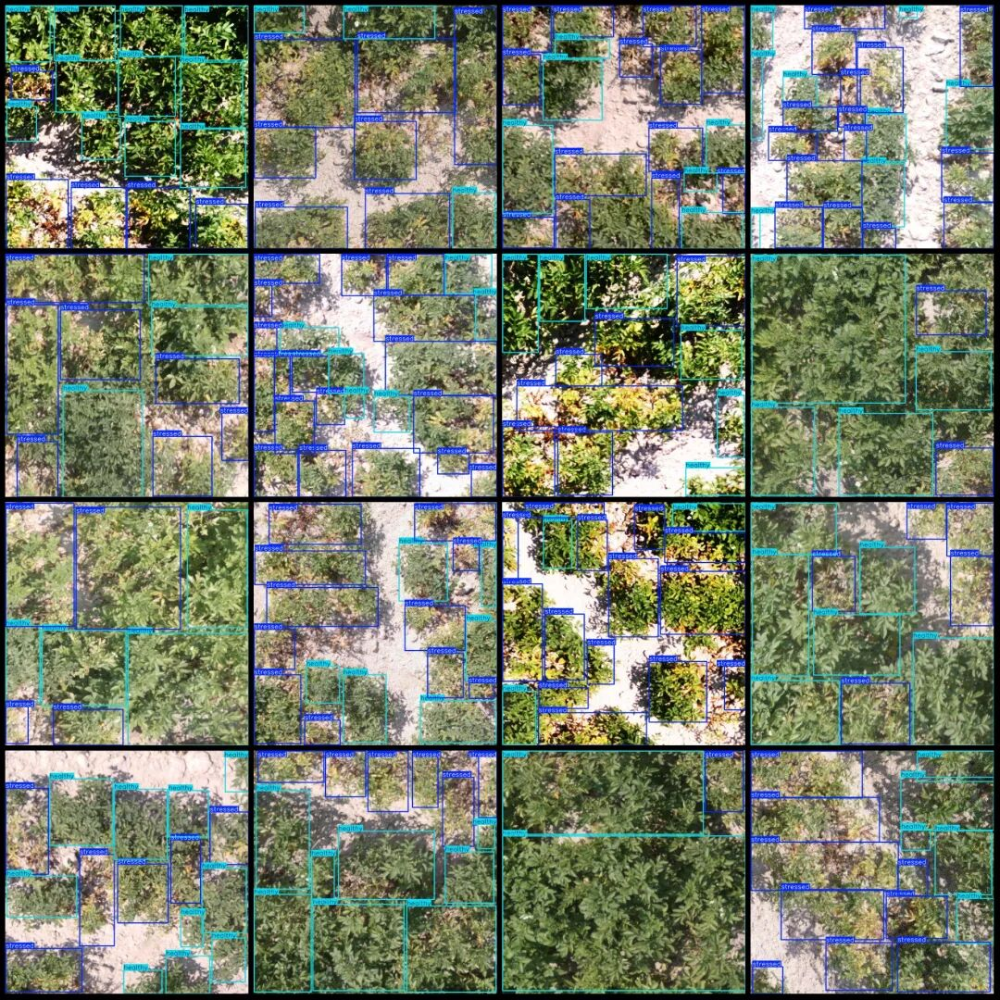
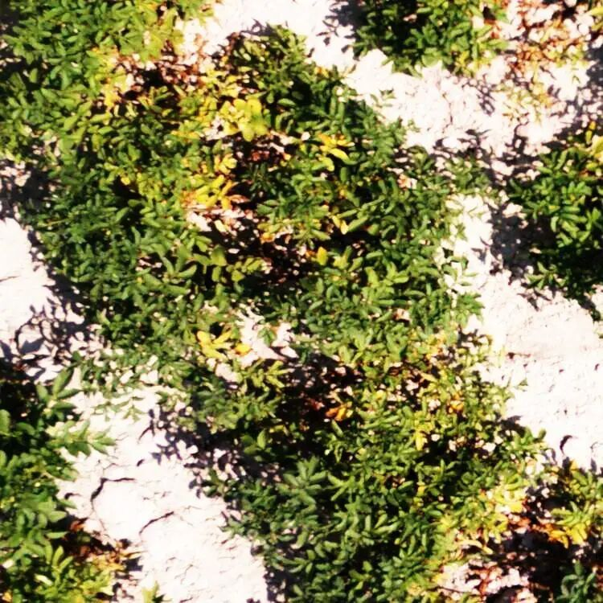
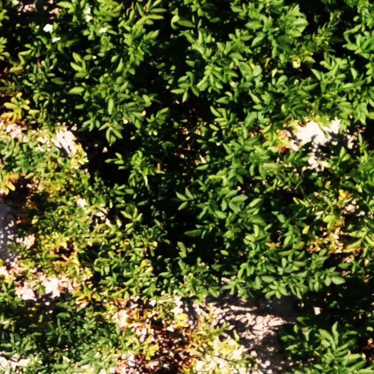

# Dataset of Plant Disease Detection from Drone Perspective in VOC+YOLO format with 1539 images in 2 categories

Please note that the images in the dataset appear somewhat unclear overall. Please refer to the following image for a closer look.

Dataset format: Pascal VOC format + YOLO format (txt file without split path, only containing jpg images and corresponding VOC format xml files and yolo format txt files)

Number of images (number of jpg files): 1539

Number of annotations (number of xml files): 1539

Number of annotations (number of txt files): 1539

Labeling category count: 2

Label category names (Note that the order of categories in the YOLO format does not correspond to this, but is based on the classes.txt file in the labels folder): ["healthy", "stressed"]

Number of boxes labeled in each category:

Healthy (health) frame count = 8478

Stressed (diseased plants) frame count = 12436

Total frames: 20914

Image resolution: 750x750

Drone: DJI Mavic Pro

Collection height: 2-10m

Sampling angle: 90°

Using labelImg:

Annotation rules: Draw a rectangle around the category.

Important Notice: No

Special : This dataset does not guarantee the accuracy of the trained models or weight files.

Image Preview:

Annotation example:

Close-up photo:

The overall image is quite similar in clarity.

## Payment

Here is a pay link on Stripe ( https://buy.stripe.com/3cs8yP7sY87d0vu9AB ). Please contact me lonlonago@foxmail.com after funding $89, and I will send you a complete data files , thank you!

